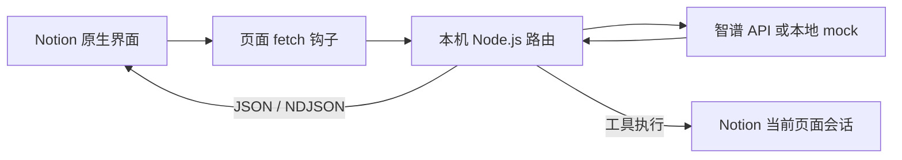

# 协议与实现概览

本项目将 Notion 原生界面的部分 AI 请求转交本地 Node.js 路由，再将模型结果转换为客户端预期的响应。它通过本机 CDP 临时注入 `fetch` 钩子，不修改应用包。

## 已适配的请求

| 入口 | 响应与处理 |
| --- | --- |
| `runInferenceTranscript` | 经典 NDJSON transcript，包含固定 step、压缩 patch 与最终同步 |
| `createAgentThread` / `sendEventToAgentThread` | personal Agent 创建、富文本用户消息、发送与中断 |
| `getThreadTranscript` / `listenToThreadTranscript` | 本地分页、订阅、增量实体与结束状态 |
| `runWriter` | 选区编辑的 JSON 响应、原生差异预览与接受 |
| `undoAgentServiceTurn` | 仅接管本进程创建且带专用标识的 Writer 撤销 |

正常结束需要正确的业务终态；仅收到网络 EOF 不视为成功。新版 Agent 使用 `turn_completed.stop_reason = "end_turn"` 和 idle session。工具状态为 Notion 富文本数组，具体说明见 [工具卡片协议](tool-card-protocol.md)。

智谱端使用 Chat Completions SSE。`src/providers/zhipu.js` 处理流式正文、思考、工具分片、鉴权/限流/断流与取消；`src/router.js` 负责协议转换及页面工具执行上下文。模型服务端点由 profile 显式指定。

## 数据流

Notion Cookie 留在页面中。聊天文字、编辑器选区，以及启用工具后读取的页面内容和工具结果会交给所选模型。普通 Notion 请求沿原路径执行。

## 研究与验证范围

初始协议研究基于 2026-10-27 的 Scoop Notion 7.40.1 安装文件和该应用的 Chromium 缓存。桌面版本与网页构建是不同身份；静态消费者代码只能说明客户端边界，不能说明 Notion 后端使用哪种模型或供应商协议。

另观察到的桌面 `clientMcpHost` 使用独立 WebSocket 工具通道，不等于工作区页面工具接口。本项目的工作区工具通过当前页面会话中的限定内部 API 执行。

后续已有原生聊天、工具与编辑器集成验证，具体范围见 [开发状态](project-status.md) 和 [编辑器适配](editor-ai.md)。内部 API 与网页构建可能变化；静态分析、自动测试和特定构建实测分别提供不同范围的证据。

本机 `research/` 包含原始报告、样本清单、提取的第三方文件及分析证据，整个目录已忽略。仓库保留本概览及独立实现，不分发原始应用文件。文档中的本地证据 ID 仅用于本机追溯，不代表仓库包含证据服务或原始抓取数据。
